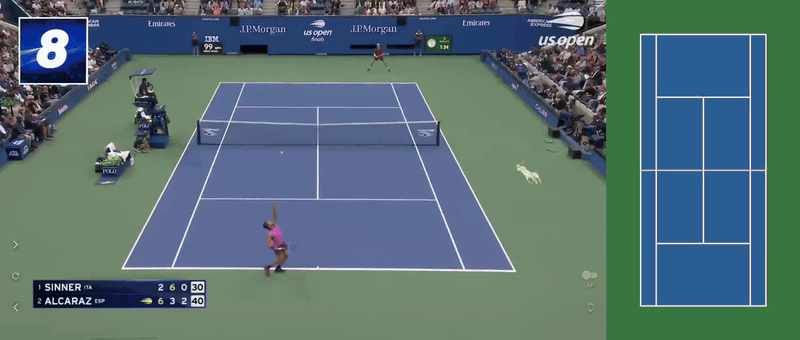
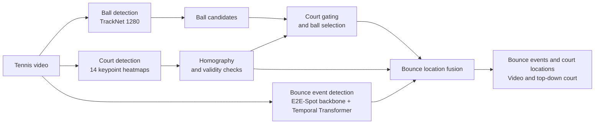

<a name="readme-top"></a>

---


## About This Project

**A tennis computer vision project combining ball tracking, court geometry, and bounce event detection.**

RallyVision explores how to analyze tennis broadcast footage through three independent machine learning subsystems: ball detection and tracking, court detection and homography, and bounce event detection. Each subsystem has its own training, evaluation, and experimental workflow.

The integrated pipeline combines their outputs to detect bounce events and estimate their locations on a top-down court. The project documents not only the final models, but also the diagnostics, oracle experiments, failed approaches, and engineering decisions that shaped them.


> [!NOTE]
> **Watch RallyVision in action below.** The demo GIF may take a moment to load.



*Alcaraz vs. Sinner broadcast footage analyzed by RallyVision. The model detects 11 of the 12 annotated first bounces in this rally, missing the final drop shot bounce. Detected events are mapped onto a top-down court; the estimated locations have not been validated against ground truth and must not be used for line calling.*


**See each subsystem in action on the same match footage: [Ball Tracking](./src/rallyvision/ball_tracking/) · [Court Detection](./src/rallyvision/court_detection/) · [Bounce Detection](./src/rallyvision/bounce_detection/).**

<p align="right">(<a href="#readme-top">back to top</a>)</p>

## Table of Contents

- [Module-First Architecture](#module-first-architecture)
- [Research Journey & Key Decisions](#research-journey--key-decisions)
- [Datasets & Evaluation](#datasets--evaluation)
- [Run Locally](#run-locally)
- [Known Limitations](#known-limitations)
- [Potential Next Steps](#potential-next-steps)
- [References](#references)

<p align="right">(<a href="#readme-top">back to top</a>)</p>

## Module-First Architecture

RallyVision consists of three independent machine learning subsystems. Each can be trained, evaluated, and studied on its own; the final pipeline brings their predictions together without jointly training the models.

- **[Ball Detection & Tracking](./src/rallyvision/ball_tracking/)** uses a TrackNet-style heatmap model and motion-aware ball selection to estimate the ball’s trajectory.
- **[Court Detection & Homography](./src/rallyvision/court_detection/)** detects 14 court keypoints and estimates a per-frame transformation between image and court coordinates.
- **[Bounce Event Detection](./src/rallyvision/bounce_detection/)** uses a pretrained E2E-Spot visual backbone and a separately trained Temporal Transformer to identify bounce events directly from video.

The integration pipeline uses court geometry to help filter ball candidates, then combines the predicted bounce times, ball positions, and valid homographies to estimate bounce locations on the court.





*For the experiments and trade-offs behind these choices, see **[Research Journey & Key Decisions](#research-journey--key-decisions)**.*

<p align="right">(<a href="#readme-top">back to top</a>)</p>

## Research Journey & Key Decisions

**From trajectories to events.** The first bounce detector used image-space ball trajectories and a gradient-boosted decision tree. It was interpretable and worked with limited training data, but depended on reliable tracks and visible changes in motion.

**Improving ball tracking.** A 1280×720 model improved detection over the original 640×360 model. Motion-aware selection reduced switches to players and other objects, while introducing a trade-off: some fast-moving balls could also be rejected.

**Considering physical modeling.** A 3D trajectory model incorporating velocity, gravity, air resistance, and bounce dynamics was considered as a way to reason about ball motion beyond its 2D image projection. A separate simulation used physical trajectories to study sub-frame bounce localization, but reconstructing a 3D trajectory from video introduces additional complexity and was not implemented in the final pipeline. The simulated localization results have not been validated on real video.

**Adding visual and temporal context.** Better ball tracks alone did not resolve every event detection challenge. An early Transformer using trajectory and local image features performed poorly on a separate broadcast clip. The final model combines an externally pretrained E2E-Spot visual backbone with a Temporal Transformer trained for this project.

**Mapping events onto the court.** A separate keypoint model estimates and checks the court homography. The pipeline uses valid geometry to place detected bounces on a top-down court; these estimated locations have not yet been validated for accuracy.

<p align="right">(<a href="#readme-top">back to top</a>)</p>

## Datasets & Evaluation

Each subsystem is evaluated on its own task and dataset. These results use different metrics and protocols and should not be compared as a single system-level score.

**Ball Detection & Tracking.** The ball model was trained and evaluated on the [TrackNet tennis dataset](https://github.com/yastrebksv/TrackNet), with matches separated between training and validation. On three held-out validation matches, the 1280×720 model achieved **0.954 precision, 0.967 recall, and 0.960 F1**, using a 20-pixel matching tolerance at the model's input resolution.

**Court Detection & Homography.** The court model uses [tennis-court-all, version 1](https://universe.roboflow.com/iris-kocht/tennis-court-all-m6vta), by iris-kocht (CC BY 4.0), with images re-split by source video. On 210 validation images, it achieved **0.982 keypoint F1** at a 0.5 detection threshold and a 5-pixel tolerance in 640×360 coordinates. Homography validity checks passed on all 210 images. The held-out court test split has not yet been evaluated.

**Bounce Event Detection.** The Temporal Transformer was trained on the [OpenSportsLab tennis localization dataset](https://huggingface.co/datasets/OpenSportsLab/soccernetpro-localization-tennis), which provides E2E-Spot tennis event clips and labels. On a test set of nine matches held out from training and validation, it achieved **0.759 ± 0.028 bounce F1** (mean ± standard deviation across three seeds) at a tolerance of ±4 frames. The validation-selected seed achieved **0.785 F1**, compared with **0.653** for the E2E-Spot GRU under the same evaluation protocol.

An independent audit checked data splits, label alignment, and evaluation for the saved Transformer seed. The other two seed results come from the original evaluator. Further experimental details and limitations are documented in the individual modules.

<p align="right">(<a href="#readme-top">back to top</a>)</p>

## Run Locally

RallyVision runs locally on Apple Silicon using PyTorch and MPS. The pipeline accepts a tennis video and combines the three subsystems to produce bounce events and estimated court locations.

The CLI requires the trained ball, court, and Transformer weights, as well as the external [E2E-Spot code](https://github.com/jhong93/spot) and its pretrained tennis model. Their expected locations are listed in [`configs/paths.yaml`](./configs/paths.yaml). The project weights and external dependency are currently kept locally and are not included in the repository. The E2E-Spot checkout used for the local demo also required NumPy compatibility changes and an MPS-compatible padding change; its Python dependencies include `timm` and `tabulate`.

Once the package and required models are available, run:

```bash
rallyvision --video match.mp4 --out results/match
```

The output directory contains:

- `rally.mp4`: the source video alongside the top-down court visualization.
- `bounce_map.png`: estimated bounce locations on the court.
- `bounces.json`: predicted bounce events and court coordinates.
- `analysis.npz`: intermediate ball tracks, homographies, and event probabilities.

FFmpeg is required to render the output video. Use `--no-video` to run the analysis without rendering.

<p align="right">(<a href="#readme-top">back to top</a>)</p>

## Known Limitations

- **Not for line calling.** Bounce locations are estimated from ball positions and court homography. Their accuracy has not been validated against ground-truth court locations.
- **Broadcast viewpoints.** The system is primarily designed for standard tennis broadcast footage. It has not been validated for spectator or side-court viewpoints.
- **Difficult bounce events.** The model can miss events, including the final drop shot bounce in the demo.
- **Evaluation coverage.** The court model has not been evaluated on its held-out test split. Bounce detection performance also varies across test footage.
- **Local setup.** The trained project weights are not currently distributed with the repository, and the external E2E-Spot dependency requires additional setup.

<p align="right">(<a href="#readme-top">back to top</a>)</p>

## Potential Next Steps

- **Investigate difficult events.** Analyze missed bounces such as the demo's final drop shot. Player and racket motion, occlusion, and visual features are possible factors, but their effects have not yet been studied.
- **Improve event detection.** Expand and diversify the training data, then evaluate whether further training or model changes improve performance on difficult events and across broadcast conditions.
- **Validate bounce locations.** Collect ground-truth court positions and measure localization error. This is a necessary step before exploring whether the system could support line calling.
- **Explore 3D trajectory modeling.** Investigate whether physical motion models can complement visual detection and 2D tracking. The current pipeline does not reconstruct 3D trajectories.

<p align="right">(<a href="#readme-top">back to top</a>)</p>

## References

- Huang et al. (2019). [TrackNet: A Deep Learning Network for Tracking High-speed and Tiny Objects in Sports Applications](https://arxiv.org/abs/1907.03698).
- Hong et al. (2022). [Spotting Temporally Precise, Fine-Grained Events in Video](https://www.ecva.net/papers/eccv_2022/papers_ECCV/html/3387_ECCV_2022_paper.php).
- Vaswani et al. (2017). [Attention Is All You Need](https://arxiv.org/abs/1706.03762).

<p align="right">(<a href="#readme-top">back to top</a>)</p>
