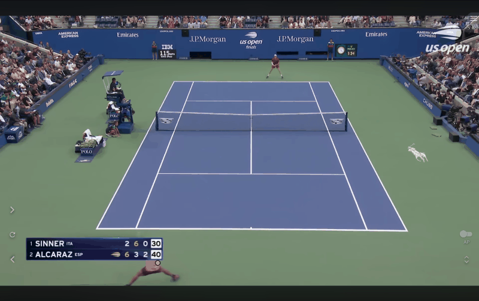
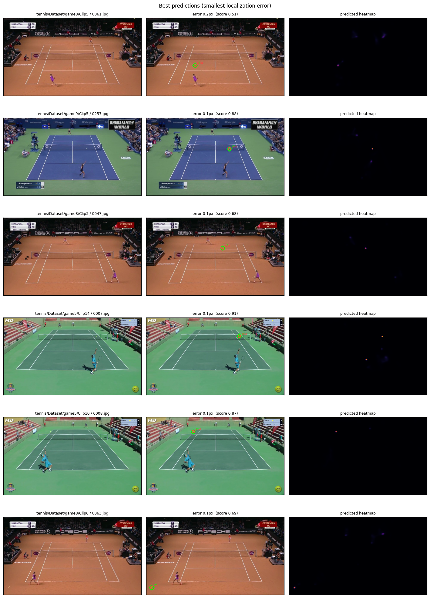
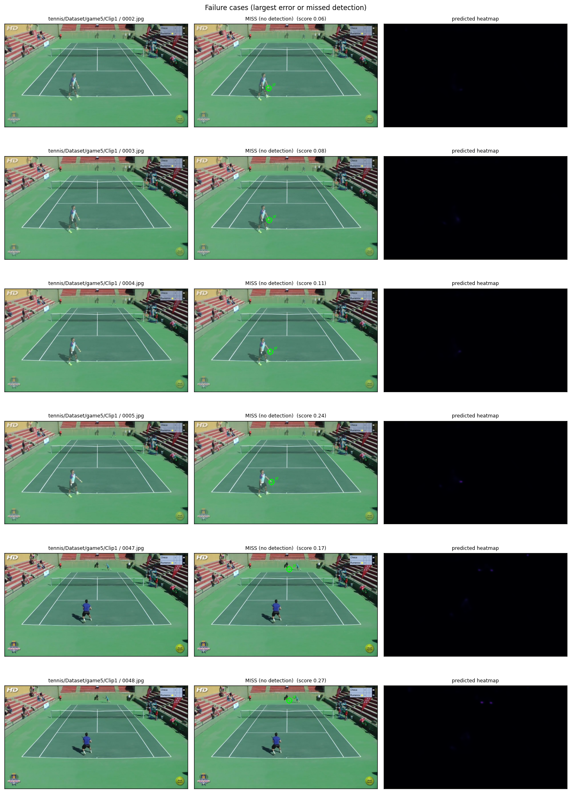

<a name="readme-top"></a>

---

## About This Module

**A heatmap-based tennis ball detector and tracker for broadcast video.**

This module detects a small, fast-moving tennis ball with a TrackNet-style model and follows it using motion-aware selection. It includes data preparation, training, evaluation, inference, and diagnostic experiments. The final 1280×720 model is integrated with the court and bounce detection subsystems in the [RallyVision pipeline](../../../).


> [!NOTE]
> **Watch the ball tracking demo below.** The GIF may take a moment to load.



*Alcaraz vs. Sinner broadcast footage. This visualization uses the 1280 model and the integrated pipeline's court gating and motion-aware ball selection. It is an illustrative example, not an accuracy measurement.*


On the TrackNet validation split, the 1280 model achieved **0.960 F1 and 0.967 recall**, compared with **0.900 F1 and 0.870 recall** for the earlier 640 model. These results use different threshold-selection and decoder settings; see [Evaluation](#evaluation) for the comparison.

<p align="right">(<a href="#readme-top">back to top</a>)</p>

## Table of Contents

- [Evaluation](#evaluation)
- [Model Architecture](#model-architecture)
- [Research Journey](#research-journey)
- [Code and Usage](#code-and-usage)
- [Known Limitations](#known-limitations)
- [References](#references)

<p align="right">(<a href="#readme-top">back to top</a>)</p>

## Evaluation

On TrackNet validation games 5, 8, and 9, a detection is a hit when it is within 20 px at 1280×720, equivalent to 10 px at 640×360. A detection outside the tolerance counts as both a false positive and a false negative.

| Detector | Threshold and selection | Precision | Recall | F1 |
|---|---|---:|---:|---:|
| Early 640×360 model | 0.18, selected on validation | 0.9327 | 0.8700 | 0.9003 |
| Final 1280×720 model | 0.16, selected on training games | 0.9539 | 0.9668 | **0.9603** |

The 1280 checkpoint was selected using validation performance. The evaluations also used different minimum blob-area settings, so the rows are not a controlled resolution-only ablation. These are detector results on the TrackNet validation split, not end-to-end pipeline or broadcast-video accuracy.

The higher-resolution input contains four times as many pixels, increasing computation and memory demands. A comparable 640-versus-1280 latency benchmark has not been recorded.

*Historical benchmark:* The original 640×360 model was separately exported and benchmarked on an Apple M3 Pro. Its fp16 Core ML model measured a median 18.74 ms per inference with `ALL` compute units, reported as 52.5 FPS. This model-only benchmark does not measure the 1280 model or the full RallyVision pipeline, which runs locally using PyTorch and MPS.

<p align="right">(<a href="#readme-top">back to top</a>)</p>

## Model Architecture

The detector stacks three RGB frames as a nine-channel input. A VGG-style encoder and decoder produce a full-resolution heatmap whose peaks represent possible ball locations. Training uses Gaussian targets and a penalty-reduced focal heatmap loss to address the imbalance between ball and background pixels.

```text
Three video frames
       ↓
9-channel frame stack
       ↓
TrackNet-style encoder and decoder
       ↓
Full-resolution ball heatmap
       ↓
Candidate peaks → motion-aware selection → ball track
```

The original model used 640×360 inputs. The final model was fine-tuned at 1280×720. At inference, frames are selected by time so that their spacing approximates the 30 fps training data. The integrated pipeline can also use a valid court homography to filter candidates before ball selection.

<p align="right">(<a href="#readme-top">back to top</a>)</p>

## Research Journey

**Starting with the 640 model**

The initial model combined three frames to provide motion cues and used a full-resolution heatmap to locate a small object without further output-stride quantization. Keeping invisible-ball frames during training also gave the model examples where an empty prediction was appropriate. Augmentations were applied consistently across each frame stack so they did not create artificial motion.

Early validation suggested high precision but lower recall at a confidence threshold of 0.5. The following images show examples from that **earlier 640×360 model**, not the final 1280 model.



*Selected predictions with the smallest localization errors. Green circles show ground truth; the right column shows predicted heatmaps. These examples are selected, not representative of overall accuracy.*



*Missed detections from the early model at threshold 0.5. Low-confidence heatmap responses helped motivate the threshold investigation.*

<br>

**Recall and threshold diagnostics**

A validation sweep showed that threshold choice affected recall substantially. For the 640 model, changing the threshold from 0.5 to 0.18 increased recall from **0.7754 to 0.8700**, while precision decreased from **0.9783 to 0.9327**. F1 increased from **0.8651 to 0.9003**. The 0.18 threshold was selected on the same validation set and was not independently confirmed.

The diagnostic also uncovered an evaluation error: detections outside the matching tolerance had to count as both false positives and false negatives. After correction, even a zero threshold reached only about 0.900 recall, because the strongest heatmap peak could be in the wrong location. Lowering the threshold was useful, but it could not fix every localization failure. Errors were also concentrated near frame edges and in particular matches.

<br>

**Higher resolution and ball selection**

Distant balls occupy very few pixels. Fine-tuning the 640 model at 1280×720 improved validation precision and recall, with the new 0.16 threshold selected on training games. The higher-resolution model was also evaluated downstream with the earlier trajectory-based bounce detector. First-bounce F1 increased from 0.908 to 0.921 on validation, although the reported confidence intervals overlapped.

Broadcast footage exposed another failure mode: a strong heatmap peak could belong to a player's head, racket, or a court marking. The current selector predicts a position using recent velocity and gates candidate peaks around it. It also requires evidence before switching to a distant candidate and removes long-static tracks. In the integrated pipeline, court geometry provides an additional candidate filter when the homography is valid.

This is a trade-off. On the 640-model validation experiment, the newer selector reduced the overall wrong-object rate from **0.051 to 0.033**. On training data, however, recall for balls moving faster than 500 px/s fell from **0.936 to 0.871** relative to the earlier selector. Motion gating can reject a real ball after a sudden change in direction, and a missing observation near a bounce can make motion prediction less reliable. These tracking results are separate experiments and are not the 1280 detector metrics above.

<br>

**Protecting the data split**

An early path-parsing error grouped all clips under one dataset directory, leaving validation empty. The resulting training-set score was not a valid held-out result. The split was corrected to group clips by game, with explicit checks for empty splits and game overlap. The evaluations use seven training matches and three held-out validation matches; the validation set was also consulted during development, so it should not be treated as a completely untouched test set.

<p align="right">(<a href="#readme-top">back to top</a>)</p>

## Code and Usage

- [`data/`](./data/): dataset preparation, splits, and augmentation.
- [`training/`](./training/) and [`evaluation/`](./evaluation/): model training and evaluation.
- [`inference/`](./inference/): video detection and ball selection.
- [`analysis/`](./analysis/): recall diagnostics, motion gating, and oracle experiments.
- [`export/`](./export/): the earlier Core ML export and benchmarking workflow.

With the package and model weights configured, the standalone ball tracker can be run from the repository root:

```bash
python -m rallyvision.ball_tracking.inference.track_video --video match.mp4 --out ball.npz
```

This standalone entry point uses motion-aware selection without the court gate. The complete pipeline and its current model availability are described in the [main README](../../../#run-locally).

<p align="right">(<a href="#readme-top">back to top</a>)</p>

## Known Limitations

- Distant, blurred, occluded, or nearly stationary balls can be difficult to distinguish from other objects.
- Motion gating trades some fast-ball recall for fewer switches to incorrect objects; a missing track near a bounce can also affect subsequent localization.
- TrackNet validation was used during development. Ball detection precision and recall on independent broadcast footage have not been measured with ground-truth ball positions.
- The demonstration GIF is qualitative. Ball position alone does not validate the accuracy of the integrated system's court-space bounce locations.

<p align="right">(<a href="#readme-top">back to top</a>)</p>

## References

- Huang et al. (2019). [TrackNet: A Deep Learning Network for Tracking High-speed and Tiny Objects in Sports Applications](https://arxiv.org/abs/1907.03698).
- Law and Deng (2018). [CornerNet: Detecting Objects as Paired Keypoints](https://arxiv.org/abs/1808.01244).
- Zhou et al. (2019). [Objects as Points](https://arxiv.org/abs/1904.07850).
- Lin et al. (2017). [Focal Loss for Dense Object Detection](https://arxiv.org/abs/1708.02002).
- Loshchilov and Hutter (2019). [Decoupled Weight Decay Regularization](https://arxiv.org/abs/1711.05101).
- Simonyan and Zisserman (2015). [Very Deep Convolutional Networks for Large-Scale Image Recognition](https://arxiv.org/abs/1409.1556).
- [TrackNet tennis dataset](https://github.com/yastrebksv/TrackNet).

<p align="right">(<a href="#readme-top">back to top</a>)</p>
