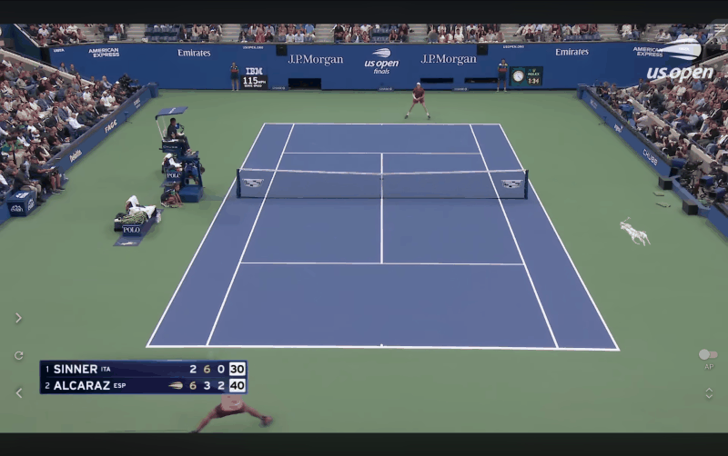

<a name="readme-top"></a>

---

## About This Module

**Tennis bounce event detection using visual features and temporal context.**

This module predicts when a bounce occurs directly from video. Its final model uses an externally pretrained E2E-Spot visual backbone and a Temporal Transformer trained for this project. The event detector does not require ball tracks or court calibration; the [RallyVision pipeline](../../../) uses those separate outputs to estimate where a detected bounce occurred.


> [!NOTE]
> **Watch the bounce detection demo below.** The GIF may take a moment to load.



*Alcaraz vs. Sinner broadcast footage. The label shows a predicted bounce event and its predicted court side. The circle marks a ball position selected from the separate tracking output near that event; it remains in place briefly for readability. This visualization is qualitative and does not validate bounce-location accuracy.*


On the held-out tennis test set, Transformer v3 achieved **0.759 ± 0.028 bounce F1** across three seeds at a tolerance of ±4 frames. The validation-selected seed achieved **0.785 F1**, compared with **0.653** for the E2E-Spot GRU under the same evaluation protocol.

<p align="right">(<a href="#readme-top">back to top</a>)</p>

## Table of Contents

- [Evaluation](#evaluation)
- [Model Architecture](#model-architecture)
- [Research Journey](#research-journey)
- [Code and Usage](#code-and-usage)
- [Known Limitations](#known-limitations)
- [References](#references)

<p align="right">(<a href="#readme-top">back to top</a>)</p>

## Evaluation

The final model uses tennis event clips and labels from [OpenSportsLab](https://huggingface.co/datasets/OpenSportsLab/soccernetpro-localization-tennis). Training and validation clips come from 19 matches; the test set contains nine different matches. Epochs, decoding parameters, and the retained seed were selected on validation.

| Model | Test bounce F1, ±4 frames | Evaluation |
|---|---:|---|
| Transformer v3, three seeds | **0.759 ± 0.028** | Mean ± standard deviation, original evaluator |
| Transformer v3, validation-selected seed | **0.785** | Independent recomputation |
| E2E-Spot GRU | 0.653 | Independent recomputation under the same protocol |

The independent comparison uses the same test clips, labels, matching, and validation-selected decoding protocol. The GRU result is computed under this project's protocol and is not the paper's mAP. Only seed 1's weights were saved, so the other two seed results could not be independently recomputed.

The audit found no test-match overlap with training, validation, or the backbone's training and validation matches. It also identified short overlaps between some training and validation clips without events in the overlapping sections, and two inconsistently labelled overlapping test clip pairs. Removing those four test clips changed v3 bounce F1 by +0.0006. The train/validation overlap may make validation slightly optimistic.

<p align="right">(<a href="#readme-top">back to top</a>)</p>

## Model Architecture

```text
Video frames
     ↓
Frozen E2E-Spot tennis visual backbone
     ↓
Per-frame visual features
     ↓
Project-trained Temporal Transformer v3
     ↓
Per-frame event probabilities → peak decoding → bounce events
```

The external E2E-Spot backbone provides 768-dimensional features. The project-trained Transformer uses three encoder layers and 100-frame windows to predict background and near/far bounce, swing, and serve classes. Overlapping window predictions are averaged. The saved model uses a validation-selected bounce threshold of 0.6 and a 15-frame non-maximum suppression window.

Videos above 40 fps are sampled at approximately 30 fps for event detection; detected event frames are mapped back to the source video. The Transformer predicts event time and side, not a court-space bounce location.

<p align="right">(<a href="#readme-top">back to top</a>)</p>

## Research Journey

**Trajectory rules and GBDT**

The initial approach proposed candidate events from changes in image-space ball motion. A rule-based baseline was interpretable but often confused hits and noisy tracks with bounces. A gradient-boosted decision tree used trajectory features to classify candidates and improved results on TrackNet footage. With predicted 640-model tracks, first-bounce validation F1 was 0.524 for the rule and 0.908 for the GBDT at ±2 frames. These historical numbers use the TrackNet dataset and must not be compared directly with the Transformer test results above.

<br>

**Diagnostics and alternatives**

Error analysis found both duplicate or shifted predictions and missed events that had candidates but scores below the threshold. Experiments with extra trajectory features, gap filling, non-maximum suppression, and event-sequence decoding did not provide consistent improvements across the development evaluations. Oracle experiments explored the effect of correcting ball positions. Some early S3 and S11 interpretations used incorrect bounce labels that were later corrected, so those particular conclusions are not treated as final evidence.

<br>

**Investigating broadcast differences and camera motion**

The early trajectory approach was developed on TrackNet footage, while the Alcaraz vs. Sinner demonstration presented different broadcast conditions, including frame rate and image scale. Such differences can change the apparent size and motion of the ball and were a reason to investigate distribution shift. The evidence does not isolate which difference caused any particular error; TrackNet itself also contains broadcast footage.

Camera motion was another hypothesis. Per-frame court homographies were used to measure how much the court moved in the Sinner video. The court was effectively stationary during the examined point, and the camera began moving after its last annotated bounce. Compensating the ball positions made very little difference in that investigation, so an additional motion-compensation stage was not adopted. This finding applies to the examined point, not all broadcast videos. See the [court module's camera motion investigation](../court_detection/#research-journey).

The final pipeline still estimates homography per frame: it uses court geometry to filter ball candidates and map detected events to court coordinates. That role is separate from compensating a trajectory for camera motion.

<br>

**From trajectories to visual features**

A small Transformer combining trajectory features and local ResNet18 image features achieved 0.888 bounce F1 on validation clips from its training match, but detected only 4 of 12 annotated first bounces in the separate Sinner clip. This limited example raised a generalization concern; it does not by itself establish why the model failed.

The final approach uses an externally pretrained E2E-Spot visual backbone and trains a separate temporal Transformer on a broader event dataset. Freezing the backbone reduces training cost and decouples event detection from ball tracking, while making the model dependent on external visual features and their training distribution.

<br>

**Training and independent audit**

Transformer v3 extended the training schedule relative to v2. Under the same decoding protocol, independently recomputed test bounce F1 increased from 0.576 to 0.785 for the saved seed. The audit separately checked label alignment, match-level separation, and metric computation. On the demo rally, v3 detected 11 of 12 annotated first bounces and missed the final drop shot. One additional prediction may correspond to a second bounce, but second bounces were not annotated.

<br>

**Physical simulation**

A separate simulation incorporated gravity, air resistance, and rebounds to study sub-frame bounce localization. Its results depended on the assumed noise and frame rate. This was a historical localization experiment, not a validated real-video 3D reconstruction, and sub-frame fitting is not used in the final pipeline.

<p align="right">(<a href="#readme-top">back to top</a>)</p>

## Code and Usage

- [`model/event_transformer/`](./model/event_transformer/): external backbone integration and project-trained Transformer.
- [`training/`](./training/) and [`evaluation/`](./evaluation/): feature extraction, training, metrics, and independent audit code.
- [`inference/`](./inference/): event prediction and decoding.
- [`analysis/`](./analysis/) and [`experiments/`](./experiments/): candidate recall, simulation, GBDT, and previous temporal approaches.

With the package, trained Transformer, and E2E-Spot code and pretrained tennis model configured, run from the repository root:

```bash
python -m rallyvision.bounce_detection.inference.predict --video match.mp4 --out bounces.json
```

This writes event predictions to `bounces.json` and per-frame probabilities to `bounces.npz`. The external dependency and model availability are described in the [main README](../../../#run-locally).

<p align="right">(<a href="#readme-top">back to top</a>)</p>

## Known Limitations

- The model can miss difficult events, including the final drop shot in the demo. The cause has not been established.
- Performance varies across test footage. The reason for the lower score on the 29.97 fps US Open subset has not been established.
- Tighter time tolerances reduce F1. The retained seed achieved 0.579 at ±2 frames and 0.403 at ±1 frame in the independent audit.
- The model targets standard broadcast footage and depends on an external pretrained backbone. Generalization to spectator or side-court views is limited.
- Event detection does not measure court-space localization accuracy and cannot be used for line calling.

<p align="right">(<a href="#readme-top">back to top</a>)</p>

## References

- Hong et al. (2022). [Spotting Temporally Precise, Fine-Grained Events in Video](https://www.ecva.net/papers/eccv_2022/papers_ECCV/html/3387_ECCV_2022_paper.php). [Code](https://github.com/jhong93/spot) and [pretrained models](https://github.com/jhong93/e2e-spot-models).
- Vaswani et al. (2017). [Attention Is All You Need](https://arxiv.org/abs/1706.03762).
- [OpenSportsLab tennis localization dataset](https://huggingface.co/datasets/OpenSportsLab/soccernetpro-localization-tennis).

<p align="right">(<a href="#readme-top">back to top</a>)</p>
