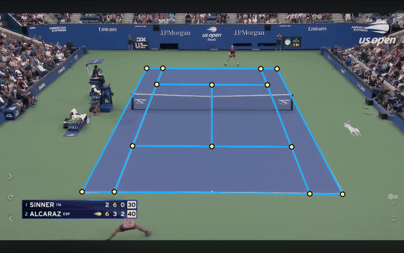
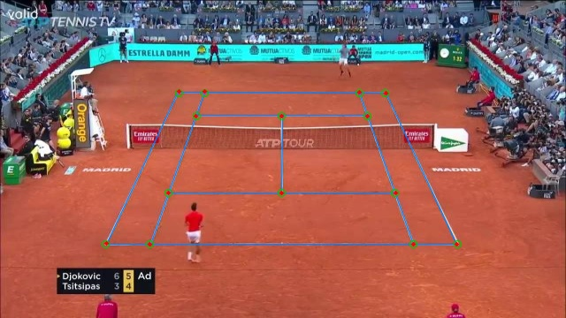
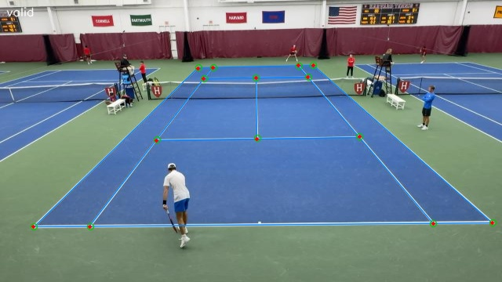
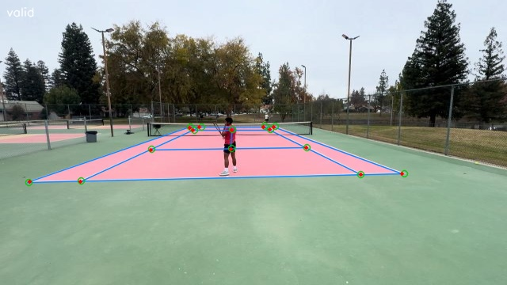

<a name="readme-top"></a>

---

## About This Module

**Court keypoint detection and homography estimation for tennis broadcast footage.**

This module predicts 14 court keypoints as heatmaps and estimates a per-frame mapping between court coordinates and image pixels. It has its own data preparation, training, evaluation, and inference code. The [RallyVision pipeline](../../../) uses valid court geometry to filter ball candidates and place predicted bounces on a top-down court.


> [!NOTE]
> **Watch the court detection demo below.** The GIF may take a moment to load.



*Alcaraz vs. Sinner broadcast footage. The points and court lines are projected from each frame's estimated homography; they are not necessarily individual keypoint detections. This is a qualitative example.*


On 210 validation images, court v2 achieved **0.9823 keypoint F1** at a 5-pixel tolerance. Homography validity checks passed on all 210 images. These are validation results, not measurements of real-world bounce-location accuracy.

<p align="right">(<a href="#readme-top">back to top</a>)</p>

## Table of Contents

- [Evaluation](#evaluation)
- [Model Architecture](#model-architecture)
- [Research Journey](#research-journey)
- [Code and Usage](#code-and-usage)
- [Known Limitations](#known-limitations)
- [References](#references)

<p align="right">(<a href="#readme-top">back to top</a>)</p>

## Evaluation

Court v2 was evaluated on 210 validation images with a confidence threshold of 0.5. A keypoint is a hit if its detected location is within 5 pixels of its label at the 640×360 model resolution.

| Metric | Validation result |
|---|---:|
| Keypoint precision / recall / F1 | 0.9900 / 0.9748 / **0.9823** |
| Detected keypoint error, median / p90 | 0.94 / 2.10 px |
| Homographies passing validity checks | 210 / 210 |
| Projected keypoint error, median / p90 | 0.89 / 2.07 px |

A separate validation sweep selected threshold **0.20** for inference; the table above reports the evaluation at 0.5. Threshold selection used the validation set, and the held-out test split has not yet been evaluated. Validity checks measure geometric consistency, not bounce-location accuracy in metres.

**Validation examples**

The following selected images show court v2 predictions from the validation evaluation at threshold 0.5. Green circles are labelled keypoints, red dots are detected keypoints, and blue lines show the court projected by the fitted homography. The `valid` label indicates that the fit passed geometric checks. These examples illustrate the outputs and do not replace the aggregate evaluation above.








<p align="right">(<a href="#readme-top">back to top</a>)</p>


## Model Architecture

The model uses a TrackNet-style encoder and decoder with a single 640×360 RGB frame as input and **14 output heatmaps**, one per court keypoint. Unlike the ball detector, it does not stack three frames.

```text
Video frame → 14 keypoint heatmaps → detected image points
                                         ↓
                        RANSAC homography and validity checks
                                         ↓
                         Court-to-image mapping for the frame
```

The homography is fit from court coordinates in metres to image pixels. Its inverse maps image locations back onto the court. The fit is accepted only when there are enough consistent inliers, they cover sufficient court area, the reprojection error is small enough, and the projected court is convex.

<p align="right">(<a href="#readme-top">back to top</a>)</p>

## Research Journey

**Data split and model versions**

The model uses [tennis-court-all, version 1](https://universe.roboflow.com/iris-kocht/tennis-court-all-m6vta), by iris-kocht (CC BY 4.0). Court v1 used a split in which frames from the same source video could appear in both training and validation. Court v2 re-split the data by source video to reduce this leakage. Its recorded split contains 1,256 training, 210 validation, and 173 test images. Because the splits differ, the v1 and v2 validation scores are not a controlled model comparison.

<br>

**Per-frame calibration and geometric checks**

Broadcast footage can include camera changes and close-ups, so calibration is estimated per frame. RANSAC and geometric checks reject unreliable fits instead of forcing a court position. In the integrated pipeline, a bounce whose selected ball frame has no valid homography is marked unplaced.

<br>

**Camera motion investigation**

An early hypothesis suggested that camera panning might obscure bounce-related motion. On the examined Alcaraz vs. Sinner point, however, fitted court corners moved less than 0.3 px between frames 0 and 990 at 640×360 resolution; camera movement began after the final annotated bounce. Motion compensation changed the tracked ball position by a median of only 0.05 px in that investigation, so no compensated-versus-uncompensated bounce experiment was run. This observation is specific to that point and does not establish that other broadcasts have static cameras.

<p align="right">(<a href="#readme-top">back to top</a>)</p>

## Code and Usage

- [`data.py`](./data.py) and [`training/`](./training/): data loading, video-level splitting, and training.
- [`model.py`](./model.py), [`geometry.py`](./geometry.py), and [`homography.py`](./homography.py): heatmap model, court coordinates, fitting, and validity checks.
- [`evaluation/`](./evaluation/): keypoint evaluation and threshold sweep.
- [`analysis/camera_motion/`](./analysis/camera_motion/): camera motion investigation.
- [`inference/`](./inference/): per-frame video calibration.

With the package and court weights configured, run the standalone module from the repository root:

```bash
python -m rallyvision.court_detection.inference.calibrate --video match.mp4 --out court.npz
```

The output contains per-frame homographies, validity flags, reasons, and fitting errors. Model availability and full-pipeline setup are described in the [main README](../../../#run-locally).

<p align="right">(<a href="#readme-top">back to top</a>)</p>

## Known Limitations

- The held-out court test split has not been evaluated; the inference threshold was selected on validation.
- Standard broadcast views are the primary target. Side-court or spectator views may not provide enough reliable court keypoints.
- Per-frame homographies are not temporally smoothed. Geometric validity does not establish how accurately a bounce is placed on the real court.
- Bounce-location estimates have not been validated against ground-truth court positions and must not be used for line calling.

<p align="right">(<a href="#readme-top">back to top</a>)</p>

## References

- iris-kocht. [tennis-court-all, version 1](https://universe.roboflow.com/iris-kocht/tennis-court-all-m6vta). Roboflow Universe, CC BY 4.0.
- Huang et al. (2019). [TrackNet: A Deep Learning Network for Tracking High-speed and Tiny Objects in Sports Applications](https://arxiv.org/abs/1907.03698).

<p align="right">(<a href="#readme-top">back to top</a>)</p>
